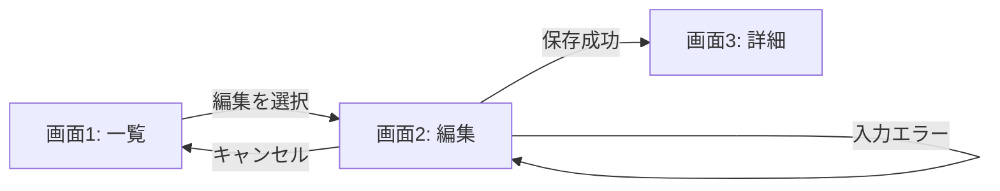
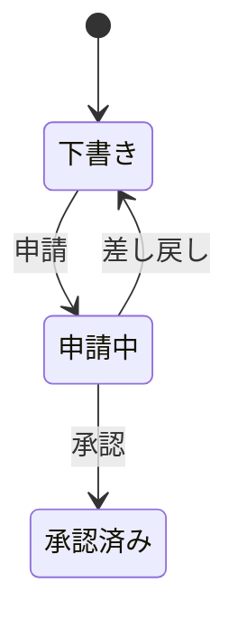
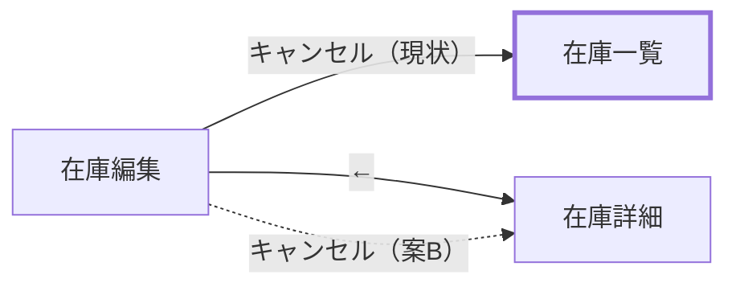

# 図解の例

以下は書式を示す架空の例。実際の説明では、確認した画面名・操作・根拠に置き換える。

## スクショと遷移図を結び付ける

保存成功時は詳細画面へ進み、入力エラー時は編集画面に留まります。



描画できない環境向けの同等の要約:

```text
画面1: 一覧 ──編集──> 画面2: 編集 ──保存成功──> 画面3: 詳細
                          ├─入力エラー──> 画面2に留まる
                          └─キャンセル──> 画面1に戻る
```

保存するMarkdownでは、実際に用意した画像だけを次の形式で参照する:

```markdown


画面2: 編集。「保存」を押すと入力チェックを行います。
根拠: 実際に確認した仕様リンクまたはソースのファイル・行。
```

## 状態遷移

画面の移動ではなく、対象データの状態を表す場合:



## 事前知識の無い人に向けた前提

製品を知らない人が、何の話か・どんな仕組みの上の話かを前提の節だけで掴めるようにする。製品 → 仕組み（図）→ なぜ作ったか → 用語の順に書く。

```html
<section id="context">
  <h2>前提</h2>
  <p>「在庫クラウド」は、会社が在庫の数を記録・共有するWebサービスで、有料プランの料金は毎月カードで払う。</p>
  <p>料金は前月分をまとめて毎月1日に請求し、カードの決済に失敗すると決まった日に再び試す。払われないまま支払期日を過ぎると、その会社は無料プランに切り替わる（図0）。</p>
  <figure>（図0: 1か月の請求・決済・停止の日程。下の「文章の日程を時間軸の図にする」の図）</figure>
  <p>この資料は、決済に失敗した後にカードを変えたとき何が起きるかを説明する。支払い画面の表示を変えるかを決めるために作った。</p>
  <dl class="terms">
    <dt>停止</dt><dd>支払期日（毎月10日）を過ぎても払われていない会社を、11日に自動で無料プランへ切り替えること。</dd>
    <dt>決済失敗の印</dt><dd>カードの決済に失敗した会社に付く印（<code>charge_failed_flg</code>）。付いている間は、プランの変更を受け付けない。</dd>
    <dt>PdM</dt><dd>プロダクトマネージャー。製品の仕様を最終的に決める担当者。</dd>
    <dt>PAY-123</dt><dd>支払い画面の表示を変えるかを決める、別の開発チケット（作業の管理番号）。</dd>
  </dl>
</section>
```

本文でも、書いた側にしか分からない言い方を、知らない人に分かる言い方に置き換える:

| 書いた側にしか分からない | 知らない人にも分かる |
| --- | --- |
| フラグが戻れば受け付ける | カードを変えると決済失敗の印が消え、プランの変更を受け付けるようになる |
| 未払いだと 422 | 未払いがあると、理由を添えたエラーになり申し込めない（422） |
| PAY-123 で PdM 判断待ち | 変えるかは、別チケット PAY-123 でプロダクトマネージャー（PdM）が決める |

## 文章の日程を時間軸の図にする

文章だけの日程は、読み手が頭の中で日付を並べ直すしかない:

> 前月分の請求は1日11:05に作られ、カード決済は1・2・4・7日の13:35に試みる。払えないまま支払期日（10日）を過ぎると、11日0:05に停止する。

時間軸の図にし、図の前の文は図から読み取る結論だけにする:

- 要点: 決済に失敗しても10日までは使え、11日の0:05に無料プランへ切り替わる。
- 図: 横軸に1日〜11日を取る。上の段に「11:05 請求を作る」（1日）と「13:35 決済」（1・2・4・7日）の印、下の段に1日〜10日の「決済に失敗しても使える」帯と、11日の「0:05 停止」の印を描く。
- 図の後: 図に載らない細部（再決済の対象になる請求の条件など）だけを書く。

「5日にカードを変え、7日に再決済され…」のような具体例の筋書きも、同じ時間軸の図に例の出来事を重ねて描く。

## 判断用の比較

フォームの「キャンセル」と上部の「←」で戻り先が違う問題を、どちらに揃えるか選んでもらう例。

**判断の基準**: 規約への準拠 / 他画面との一貫性 / 入力の破棄など利用者への影響 / 実装の手間

**規約との照合**（引用元を付ける）:

> 戻るリンクは「キャンセルボタンと同じ動作（編集内容を破棄して離脱）」
> — `<ガイドラインのファイル>`「フォームパターン > 戻るリンク」

**現状と違いの図**。案ごとに全体を描き直さず、現状の図で問題の箇所と変わる矢印だけを目立たせる:



```text
在庫編集  キャンセル  在庫一覧   現状。上部の戻ると食い違う
在庫編集  上部の戻る  在庫詳細
在庫編集  キャンセル  在庫詳細   案Bで変わる矢印
```

点線は描画系によって実線になることがある。どの矢印が変わるかはラベル（「（案B）」）で示す。

**根拠付きの比較表**。確認していない欄は「未確認」と書く:

| 観点 | 案A: 現状維持 | 案B: ← と揃える | 根拠 |
| --- | --- | --- | --- |
| 規約 | 反する | 準拠 | ガイドライン「戻るリンク」 |
| 他画面 | 一覧へ戻る画面がある | 詳細へ戻る画面がある | `<ファイル>:<行>`、`<ファイル>:<行>` |
| 入力の破棄 | 確認なしで破棄 | 確認なしで破棄 | 離脱確認の処理が無い（`<ファイル>`） |
| 利用実態 | 未確認（計測イベントが無い） | 同左 | ボタンに計測属性が無い |

**推奨**（比較とは分けて書く）: 案B。規約に準拠し、← との食い違いが無くなる。どちらの案でも入力は確認なしで破棄されるため、離脱確認は別に検討する。

## 質問に図で答える

「注文の確定から在庫の引当までどう流れるの？」のように、答えの中心が処理の流れなら、会話で先に要点を答え、`sequenceDiagram` 1枚と根拠のファイル・行だけの軽い資料を作り、回答の最後にURLを添える。

```text
（会話）注文確定時に受注サービスが在庫サービスへ引当を依頼し、在庫が足りなければ…（要点）
図: http://<アドレス>:<port>/order-allocation/explanation.html
```

「この定数の値は？」「このメソッドはどこで呼ばれている？」のように一文で答えられる質問では、資料を作らない。

## 図を参照する質問

まず同じ粒度で両案を提示する。以下のフローは提案であり、実装済み画面の証拠ではない。

```text
案A: 一覧 → 編集画面 → 保存 → 詳細画面
案B: 一覧 → 行内編集 → 保存 → 一覧に留まる
```

| 案 | 向いている操作 | 制約 |
| --- | --- | --- |
| A | 多くの項目をまとめて編集 | 画面移動が必要 |
| B | 一覧を見ながら少数項目を編集 | 行内に置ける入力欄が限られる |

AskUserQuestion入力例。質問欄を出すと直前のメッセージは隠れるので、資料のURLを質問文に、図のURLをアンカー付きで各プレビューに入れる。プレビューでは `description` が見えないことがあるので、利点・制約もプレビューに書く。`<URL>` は [viewing.md](viewing.md) で選んだ経路のURLに置き換える。

```json
{
  "questions": [{
    "question": "資料 <URL>#compare の案A・案Bのどちらの編集方法にしますか？",
    "header": "編集方法",
    "options": [
      {
        "label": "案A: 編集画面",
        "description": "専用画面で複数項目を編集。保存後は詳細画面へ移動します。",
        "preview": "案A: 編集画面\n\n操作  移動先\n編集  編集画面\n保存  詳細画面\n\n利点: 多くの項目をまとめて編集できる\n制約: 画面移動が必要\n\n図の詳細:\n<URL>#option-a"
      },
      {
        "label": "案B: 行内編集",
        "description": "一覧で少数項目を編集。保存後も一覧に留まります。",
        "preview": "案B: 行内編集\n\n操作  移動先\n編集  一覧のまま\n保存  一覧のまま\n\n利点: 一覧を見ながら編集できる\n制約: 行内に置ける入力欄が限られる\n\n図の詳細:\n<URL>#option-b"
      }
    ],
    "multiSelect": false
  }]
}
```

プレビューの表は、罫線や矢印ではなく空白で列を区切る。全角文字は2桁として数える（「操作」「編集」は4桁なので、空白2つを足して1列目を6桁にそろえる）。

実際の呼び出しでは環境のスキーマに従う。`preview` を受け付けない環境では `preview` を外し、違いを `description` に書く。HTMLや画像を `description` や文字の `preview` に埋めても描画されない。
